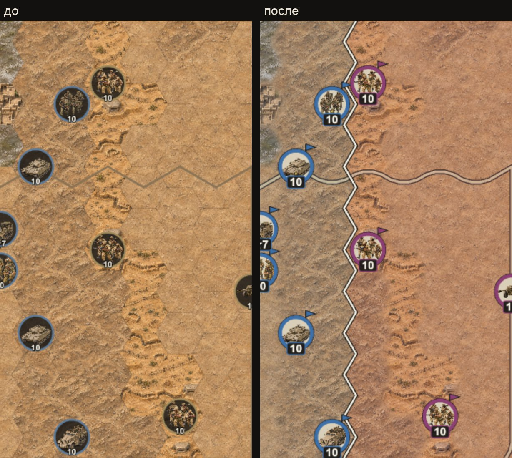
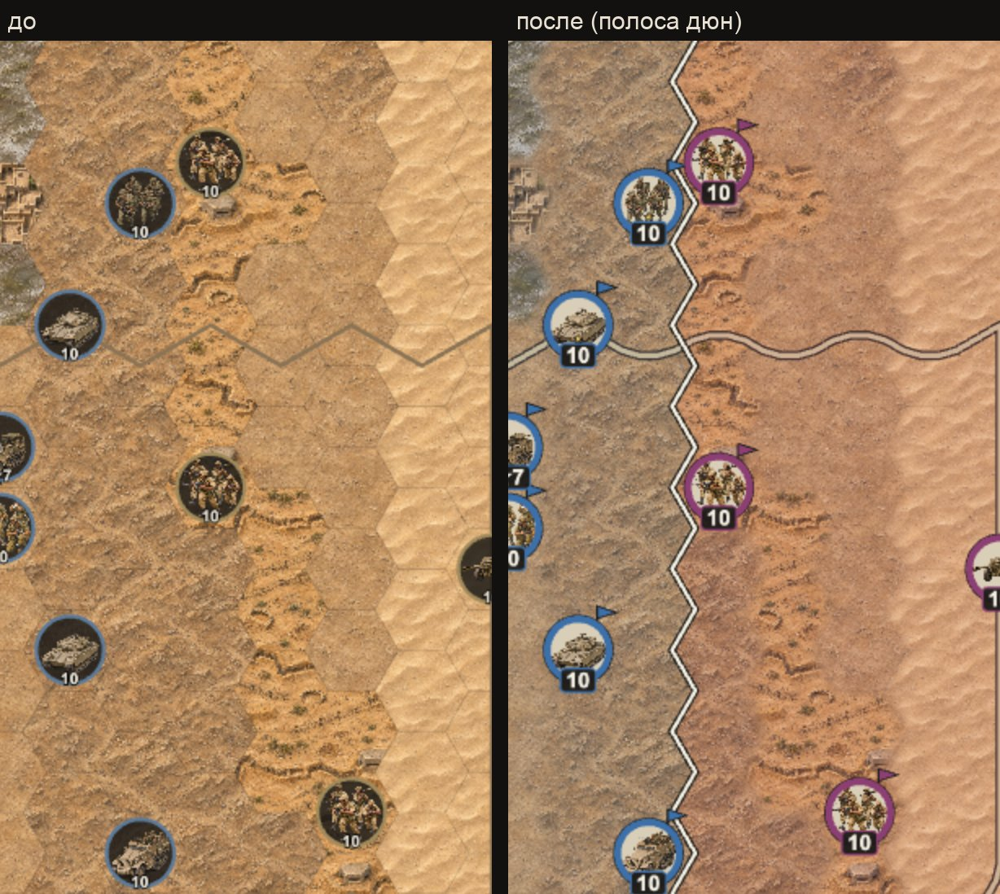
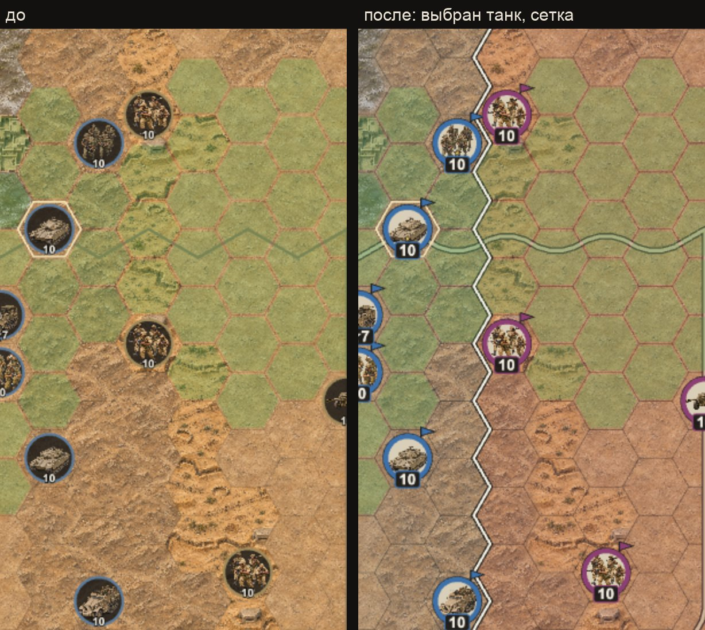
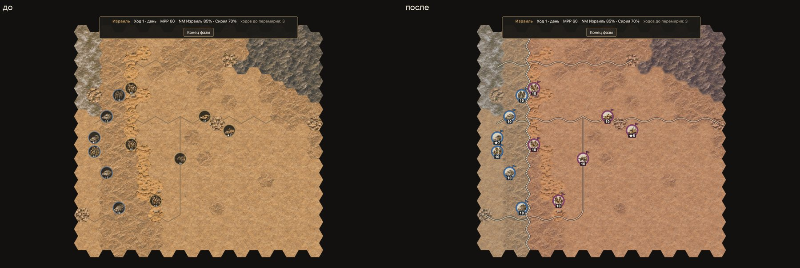
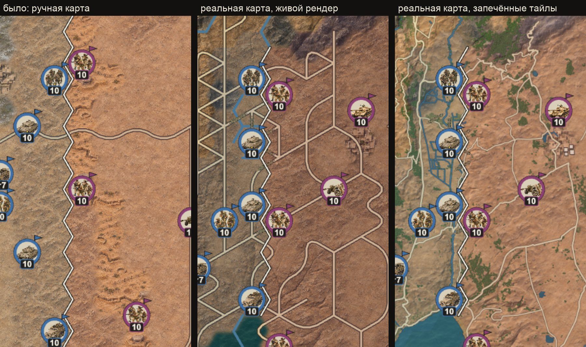
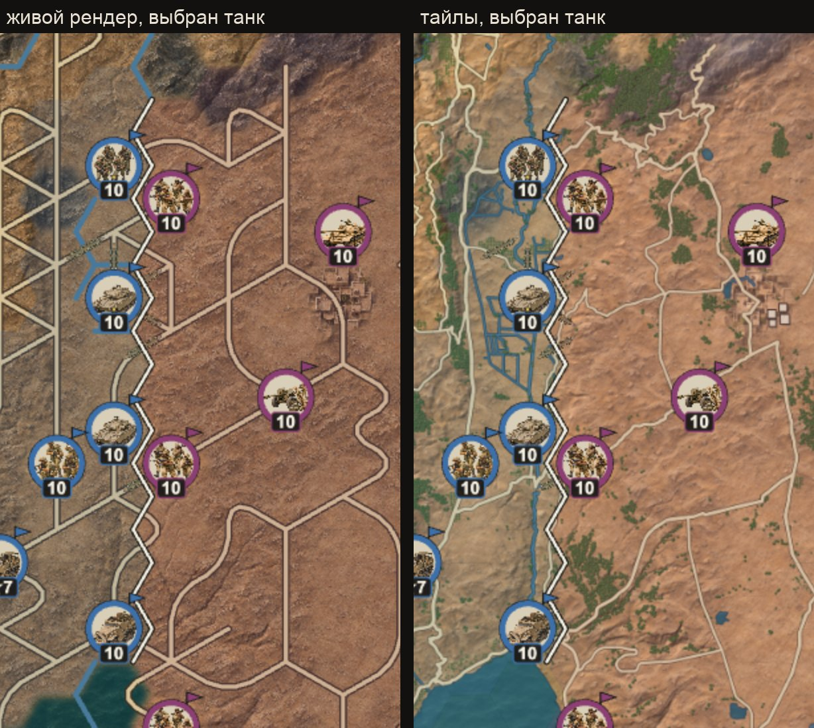
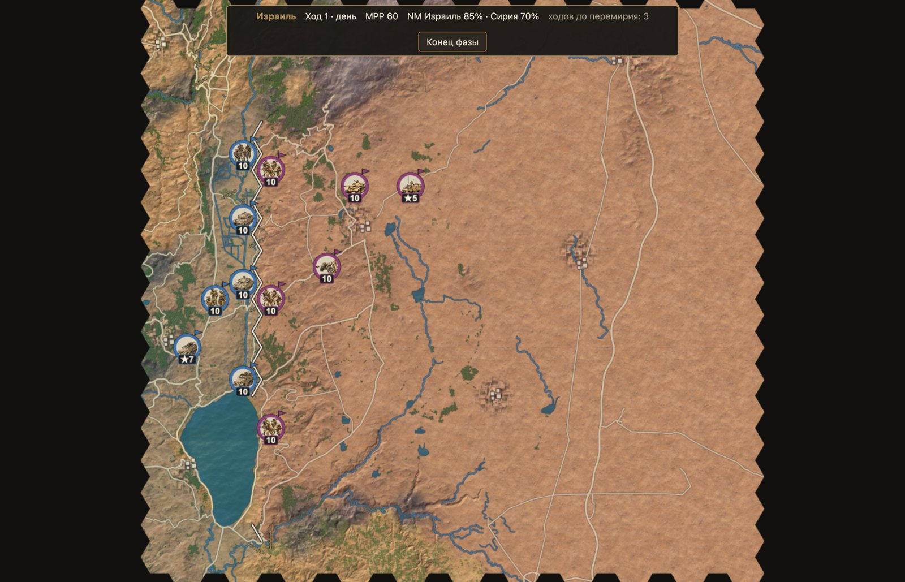
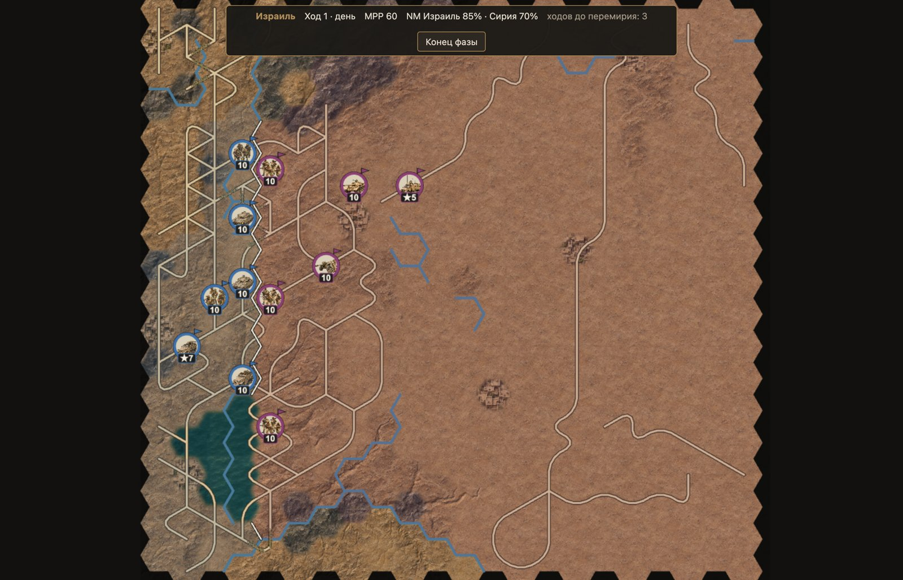
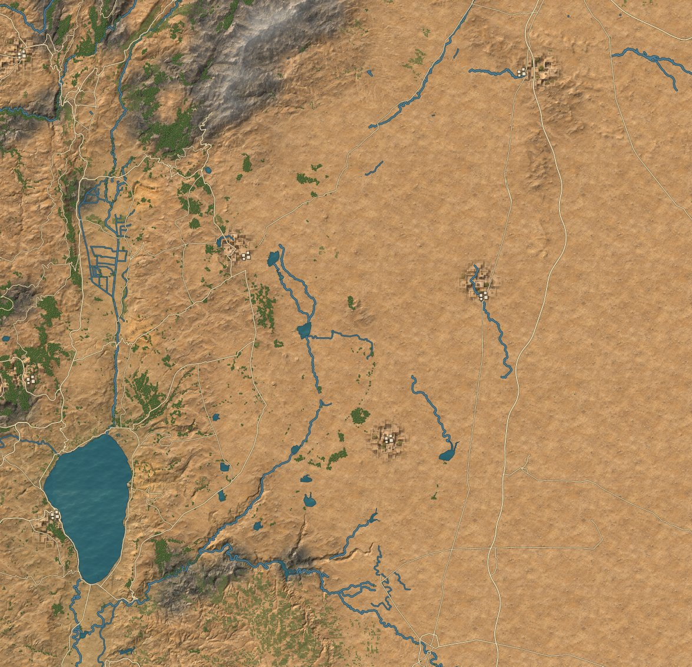

# Рендер карты: первый визуальный прогон и запечённая карта

Отчёт от 2026-11-25. Этап 2, шаг 5. Решения и открытые вопросы — в `docs/decisions.md` (R-UI-01, R-UI-02, R-UI-03).

Все скриншоты сняты одинаково: headless Chrome, окно 1400 × 900, масштаб устройства 2. Крупный план — прямоугольник от центра гекса (1, 2) до центра гекса (8, 13) при стартовой камере.

## 1. Правки рендера (живой рендер)

Пять правок, по коммиту на каждую.

1. **Юниты (R-UI-03).** Толстое кольцо и вымпел цвета стороны. Цвет задаётся в `scenario.json`, `sides[].color`. Под силуэтом светлая подложка. Сила крупной цифрой на отдельной плашке, звёзды опыта над ней.
2. **Местность.** Полотна текстур в мировых координатах, мягкие переходы по размытым маскам типов. Краёв по гексу нет.
3. **Дороги.** Идут от центра гекса к центру соседа плавной линией с обводкой. Реки и канал остаются на сторонах гексов.
4. **Контроль (R-MOVE-06).** Свои гексы залиты полупрозрачным цветом стороны. На стыке гексов разных сторон — линия фронта.
5. **Сетка.** По умолчанию почти невидима, проявляется при выборе юнита.

«Голаны-67» на прежней ручной карте:

Полоса дюн на временной копии сценария. В «Голанах-67» дюн нет.

Выбран танк, сетка проявилась:

## 2. Реальная карта и `mapgen bake`

«Голаны-67» теперь построены на реальной карте 22 × 18 гексов по 5 км. Источники: Copernicus DEM GLO-30 и OpenStreetMap. Карта поправлена в редакторе и сохранена через dev-сервер.

Поверх неё `mapgen bake` запекает живописную карту в пирамиду тайлов. Слои снизу вверх:

1. текстуры местности, смешанные по маскам типов, размытым на ¼ гекса;
2. отмывка рельефа (умножение) и лёгкий тинт по высоте;
3. озёра и реки по исходным линиям OSM, с обводкой;
4. леса и сады по OSM landuse; деревья разбросаны по сиду;
5. дороги по линиям OSM, ширина зависит от класса;
6. значки городов.

Поверх тайлов живые слои клиента: заливка контроля и линия фронта, сетка, подсветки, мосты и юниты.

Та же область: прежняя ручная карта, затем реальная карта в живом рендере (`?baked=0`), затем на тайлах.

Выбран танк: на тайлах проявляются сетка и подсветки ходов.

Вся карта на тайлах и та же карта в живом рендере:

Запечённая карта целиком, уровень пирамиды 1 (1175 × 1135 px):

### Цифры

| Параметр | Значение |
| --- | --- |
| Разрешение уровня 0 | 24 px/км, 2350 × 2269 px |
| Тайлы | 512 px, WebP без потерь, 4 уровня, 39 файлов, 11 МБ |
| Время запекания | ≈ 15 с (release, вместе с чтением четырёх выгрузок OSM) |
| Детерминизм | два прогона дают побайтно одинаковые тайлы; отпечаток `fnv1a64` в `tiles.json` |

### Что осталось

- Деревья и значки городов нарисованы процедурно: спрайтов в ассетах нет. Если в `sprites.json` появятся `map_objects.tree` и `map_objects.city`, bake возьмёт их.
- Дороги в OSM современные. Тайлы и правила берут их из одного источника, но после правки дорог в редакторе картинка и правила разойдутся до повторного запекания. Вопрос открыт в `docs/decisions.md`.
- Тайлы не обновляются сами: после правок карты в редакторе нужно снова запустить `mapgen bake`.
