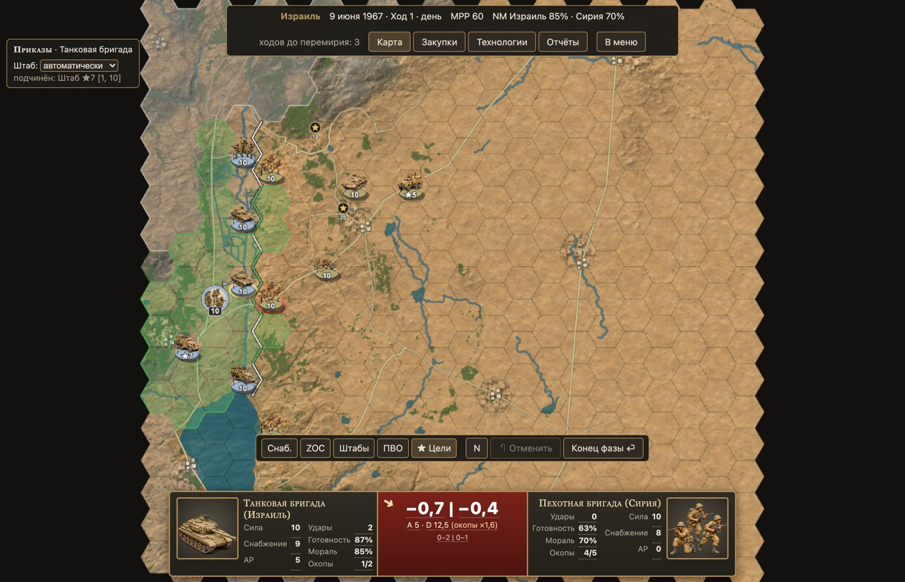
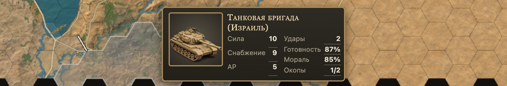

# Окно атаки и вид юнитов в духе Strategic Command

Отчёт от 2026-11-26. Правила — R-UI-03 и R-UI-04. Компоновка и состав информации те же, что в Strategic Command, графика своя. Решения записаны в `docs/decisions.md`.

## Требуемый скриншот

Выбран танк, курсор наведён на сирийскую пехоту, окно атаки открыто.

## Окно атаки (R-UI-04)

Окно стоит по центру внизу и состоит из трёх частей.

**Левая карточка — атакующий:**
- портрет: спрайт миниатюры в бронзовой рамке, отражённый по повороту юнита;
- заголовок «Название (страна)» капителью;
- звёзды опыта;
- два столбца: Сила, Снабжение, AP | Удары, Готовность, Мораль, Окопы «тек./макс.».

**Центр на красном фоне:**
- крупно ожидаемые потери «атакующий | защитник»;
- под ними A и D с главным модификатором — тем множителем, что сильнее всего отличается от 1 (местность, ночь, река/канал, окопы, опыт);
- мелко — разброс по 10-му и 90-му перцентилям (R-COMBAT-03);
- стрелка, повёрнутая по направлению атаки на карте.

**Правая карточка — защитник**, зеркально.

На всех числах есть тултипы:
- у потерь, A, D и p — раскладка формулы из входов ядра;
- у готовности — формула со штабом и усталостью;
- у снабжения, AP, окопов, силы, ударов, морали, опыта — правило с числами из `rules.json`.

Состояния окна:

| Состояние | Что видно |
| --- | --- |
| Выбран юнит без цели | только левая карточка |
| Наведение на цель | центр и правая карточка, без кнопок |
| Касание цели | то же с кнопками «Атаковать» и «Отмена»; второе касание — атака |
| После боя | около 1,1 с в центре фактические потери, затем снова карточка юнита |

Над окном — полоска кнопок:
- слои: снабжение, ZOC, штабы, зонтики ПВО, цели;
- следующий юнит (N);
- «Отменить»;
- «Конец фазы» (Enter).

В верхней панели остались сторона, дата, MPP, NM, перемирие, панели и «В меню». Приказы выбранного юнита (пополнение, переброска, штаб, мосты) — в небольшой панели слева вверху.

## Юниты (R-UI-03)

- Диск целиком залит цветом стороны, с лёгкой фаской: светлый край сверху, тёмная боковина. Израиль — светлый серо-голубой `#9fb6cc`, Сирия — песочно-оливковый `#b3a46c`. Цвета задаются в `scenario.json`.
- Миниатюра стоит на диске по `anchor` из манифеста и слегка выходит за его верхний край. Тень лежит на юго-восток.
- Внизу диска — сила белой цифрой, слева крошечный флажок. Звёзд на карте нет, они только в карточке окна.
- Выбранный юнит обведён ярким кольцом, цель атаки — красным. У юнита без AP и ударов приглушён диск.
- Поворот — как решено раньше: к противнику, затем по последнему шагу или к цели.

