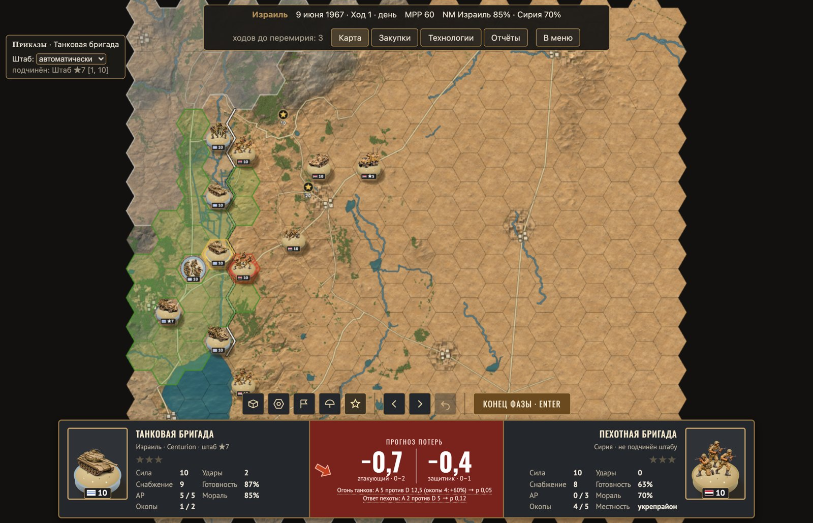
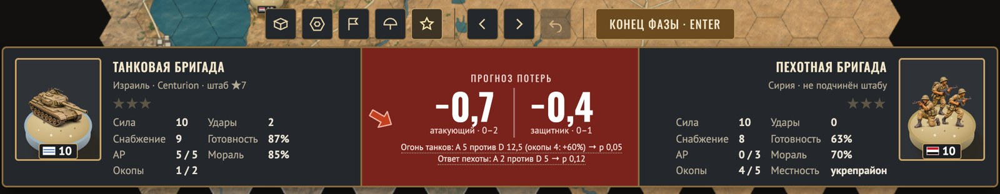
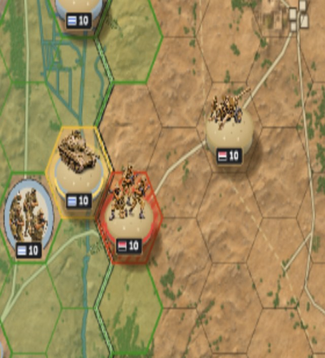
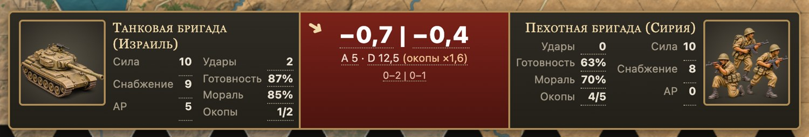
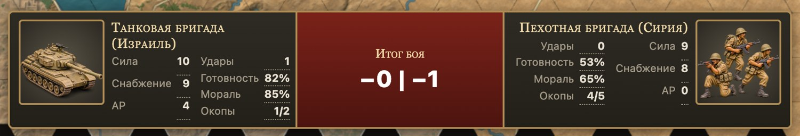
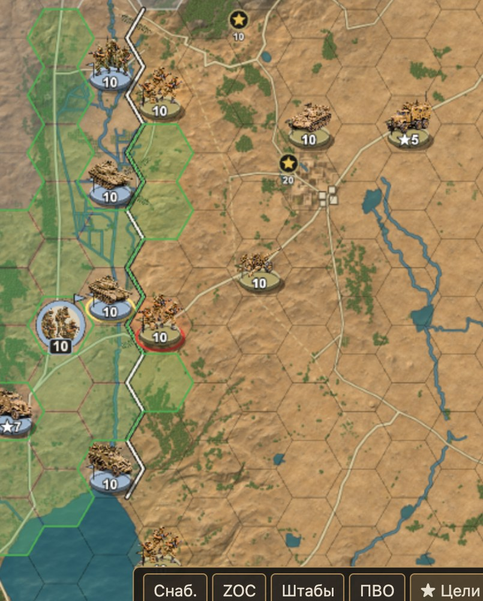

# Окно атаки и вид юнитов в духе Strategic Command

## Версия по утверждённому макету (2026-11-26)

Фишки и окно атаки переделаны по [утверждённому макету](https://claude.ai/artifact/QpR8KYZGirE9AwDzWEzDaz) (доски «Окно атаки в контексте карты» и «Фишка юнита»). Эта версия заменяет описанную ниже.

Скриншот: выбран танк, курсор наведён на сирийскую пехоту, окно атаки открыто.

### Фишка

Геометрия общая для карты и портрета в окне (`client/src/render/token-geom.ts`); w — ширина фишки, 1,5 радиуса гекса.

- **Эллипс верха:** rx = 0,47·w, ry = 0,29·w. Его центр совпадает с центром гекса.
- **Боковая полоса:** толщина 0,13·w, вертикальный градиент цвета стороны.
- **Верх:** кант цвета стороны, песочный радиальный грунт с крошкой.
- **Модель:** ширина w, стоит по `anchor` из манифеста чуть ниже центра эллипса и выступает вверх.
- **Табличка:** флажок и сила по центру передней кромки полосы. Полосы флажка берутся из поля `flag` стороны в `scenario.json`.
- **Тень:** размытый эллипс со сдвигом на юго-восток.
- **Состояния:**
  - выбранный юнит — жёлтая обводка подставки и полупрозрачный ореол;
  - цель атаки — то же красным;
  - юнит без AP и ударов приглушён целиком (насыщенность 0,35, яркость 0,78).
- **Гексы:** выбранный — жёлтый, цель — со штриховкой, доступные для хода — зелёные с обводкой.

### Окно атаки

- **Размер и сетка:** 1200 × 170, колонки 430 | центр | 430. Шрифты: Oswald в заголовках и числах, PT Sans в тексте.
- **Карточка:** портрет — фишка в бронзовой рамке. Заголовок — класс в верхнем регистре. Подзаголовок — «страна · модель · штаб»; у пехоты вместо модели уровень ПТУР, если он выше 1. Звёзды показаны из трёх. Показатели в четыре колонки: Сила | Удары, Снабжение | Готовность, AP «тек. / макс.» | Мораль, Окопы «тек. / макс.» | Местность (у защитника).
- **Центр:**
  - «Прогноз потерь»;
  - две колонки «−a атакующий · разброс 10–90%» и «−d защитник · разброс»;
  - строки «Огонь танков: A … против D … (окопы 4: +60%) → p …» и «Ответ пехоты: …»;
  - стрелка по направлению атаки на карте.
- **Тултипы:** на всех числах и строках — раскладка формулы.
- **Полоска над окном:**
  - SVG-значки слоёв: снабжение, ZOC, штабы, зонтики ПВО, цели;
  - предыдущий юнит (Shift+N), следующий (N), «Отменить»;
  - «Конец фазы · Enter».

---

## Первая версия (заменена)

Отчёт от 2026-11-26. Правила — R-UI-03 и R-UI-04. Компоновка и состав информации те же, что в Strategic Command, графика своя. Решения записаны в `docs/decisions.md`.

## Требуемый скриншот

Выбран танк, курсор наведён на сирийскую пехоту, окно атаки открыто.

## Окно атаки (R-UI-04)

Окно стоит по центру внизу и состоит из трёх частей.

**Левая карточка — атакующий:**
- портрет: спрайт миниатюры в бронзовой рамке, отражённый по повороту юнита;
- заголовок «Название (страна)» капителью;
- звёзды опыта;
- два столбца: Сила, Снабжение, AP | Удары, Готовность, Мораль, Окопы «тек./макс.».

**Центр на красном фоне:**
- крупно ожидаемые потери «атакующий | защитник»;
- под ними A и D с главным модификатором — тем множителем, что сильнее всего отличается от 1 (местность, ночь, река/канал, окопы, опыт);
- мелко — разброс по 10-му и 90-му перцентилям (R-COMBAT-03);
- стрелка, повёрнутая по направлению атаки на карте.

**Правая карточка — защитник**, зеркально.

На всех числах есть тултипы:
- у потерь, A, D и p — раскладка формулы из входов ядра;
- у готовности — формула со штабом и усталостью;
- у снабжения, AP, окопов, силы, ударов, морали, опыта — правило с числами из `rules.json`.

Состояния окна:

| Состояние | Что видно |
| --- | --- |
| Выбран юнит без цели | только левая карточка |
| Наведение на цель | центр и правая карточка, без кнопок |
| Касание цели | то же с кнопками «Атаковать» и «Отмена»; второе касание — атака |
| После боя | около 1,1 с в центре фактические потери, затем снова карточка юнита |

Над окном — полоска кнопок:
- слои: снабжение, ZOC, штабы, зонтики ПВО, цели;
- следующий юнит (N);
- «Отменить»;
- «Конец фазы» (Enter).

В верхней панели остались сторона, дата, MPP, NM, перемирие, панели и «В меню». Приказы выбранного юнита (пополнение, переброска, штаб, мосты) — в небольшой панели слева вверху.

## Юниты (R-UI-03)

- Диск целиком залит цветом стороны, с лёгкой фаской: светлый край сверху, тёмная боковина. Израиль — светлый серо-голубой `#9fb6cc`, Сирия — песочно-оливковый `#b3a46c`. Цвета задаются в `scenario.json`.
- Миниатюра стоит на диске по `anchor` из манифеста и слегка выходит за его верхний край. Тень лежит на юго-восток.
- Внизу диска — сила белой цифрой, слева крошечный флажок. Звёзд на карте нет, они только в карточке окна.
- Выбранный юнит обведён ярким кольцом, цель атаки — красным. У юнита без AP и ударов приглушён диск.
- Поворот — как решено раньше: к противнику, затем по последнему шагу или к цели.

