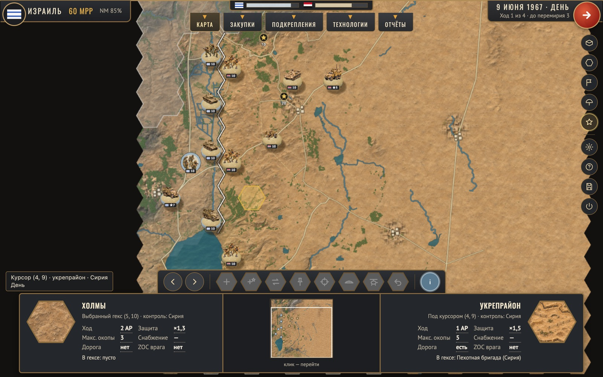
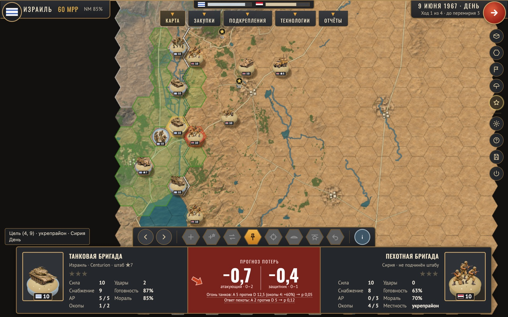
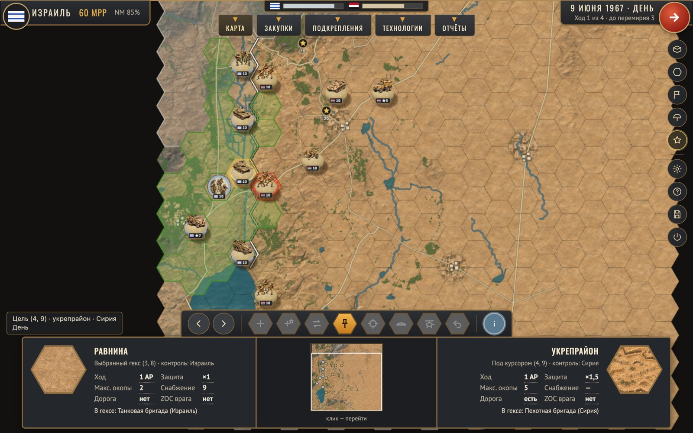
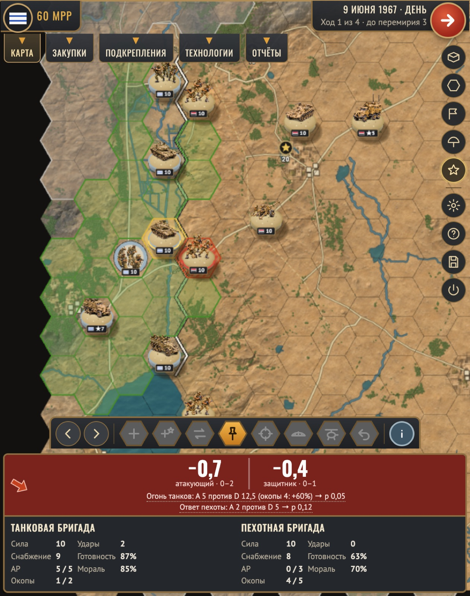

# HUD по утверждённому макету

Интерфейс собран по [утверждённому макету](https://claude.ai/artifact/QpR8KYZGirE9AwDzWEzDaz): доски «Режим атаки» и «Режим гекса», компоненты «Верхняя панель» и «Панель действий». Все снимки — «Голаны-67», ход 1, экран 1280 × 800 (последний — 600 × 760).

## Режим гекса

Юнит не выбран. Слева выбранный гекс, справа гекс под курсором, в центре миникарта с рамкой видимой области. Слева внизу — строка о гексе под курсором.

## Режим атаки

Выбрана танковая бригада, курсор наведён на пехоту. Окно атаки прежнее. Над ним панель действий: доступна только «булавка к штабу», у остальных кнопок в подсказке причина отказа от ядра («Юнит в полной силе», «Обстрел — только для артиллерии» и т. д.).

## Юнит выбран, сведения о гексе («i»)

Кнопка «i» или клавиша I переключает окно на сведения о гексах. Слева гекс выбранного юнита.

## Узкий экран

На 600 px остаются флаг и MPP слева, дата и кнопка «Конец фазы» справа; вкладки уходят под них. Окно атаки — полоса прогноза над двумя карточками.

## Что проверено

- Типы, 51 тест клиента, сборка `vite build`.
- e2e: партия «Голан-67» через интерфейс доходит до исхода.
- Кнопки: выбор штаба и цели обстрела открываются списком, щелчок по миникарте переносит камеру, «Отменить» возвращает и движение, и поворот.

## Что отличается от макета

- «Вертолётная переброска» всегда недоступна: R-AIR-04 в ядре ещё нет (этап 5).
- В строке курсора нет погоды («ясно»), а в карточке гекса — региона («Голаны»): таких данных в игре нет.
- Названия соединений («7-я танковая бригада») по-прежнему заменены классом: данных о соединениях нет.

Толкования записаны в `docs/decisions.md` (2026-11-26, «HUD по утверждённому макету»).
