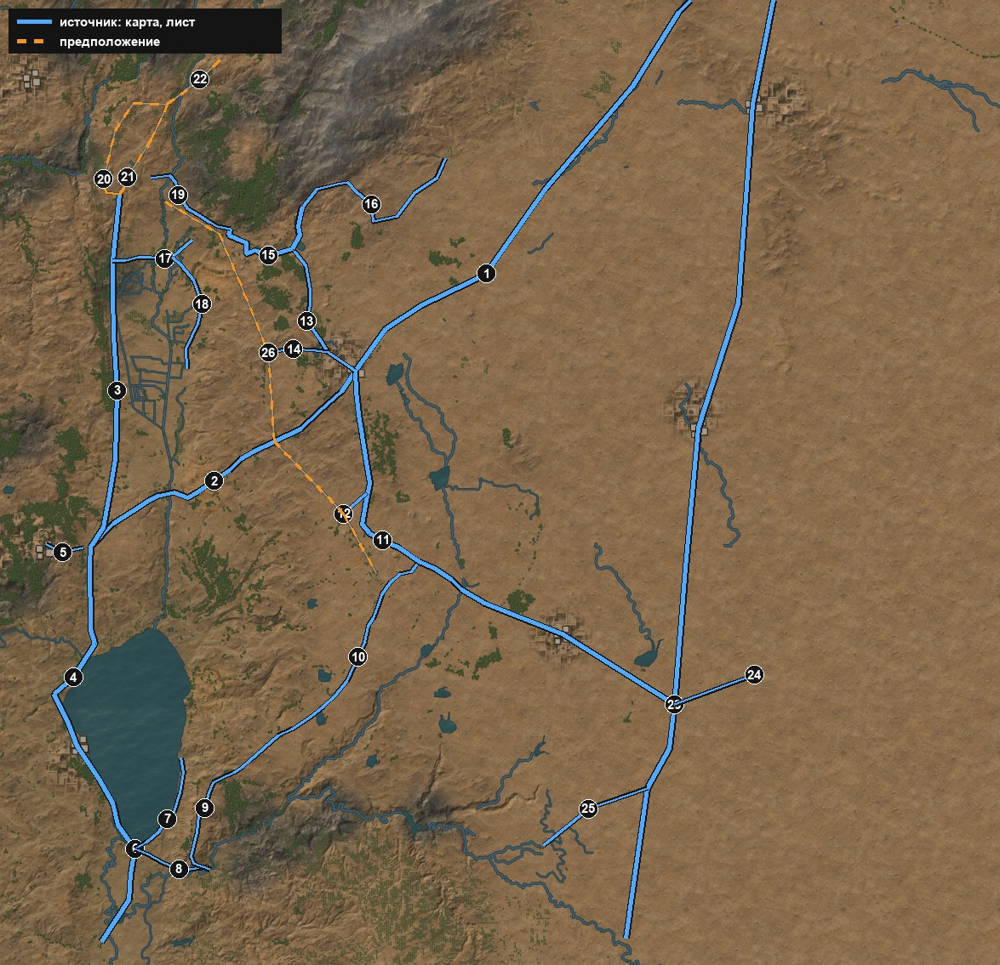

# Дороги 1967 года для «Голан-67»: слой на проверку

Отчёт от 2026-11-26. Слой `historical_roads` в `data/scenarios/golan67/map.json` лежит отдельно от данных OSM. Сейчас он включён: `roads_from: historical_roads`, а дороги OSM сохранены в `osm_backup`.

- Вернуть дороги OSM: `cargo run -p mapgen --release -- roads --map data/scenarios/golan67 --use osm`.
- Убрать слой совсем: `--remove historical`.
- После переключения карту нужно запечь заново: `mapgen bake`.

Синие сплошные линии — дороги, показанные на датированной карте. Оранжевые пунктирные — предположения. Номера на картинке соответствуют номерам в таблице.

## Итог

- **Дороги:** 26, из них 4 помечены как предположение.
- **Правила:** из слоя получилось 121 сторона гекса с дорогой (у OSM было 191) и 8 мостов. Новых перевалов нет.
- **Точность:** у части дорог с источником отдельные участки достроены. Это сказано в примечании: за краем листа 1958 года трасса проведена по мелкомасштабным картам между известными городами, с точностью около 1–2 км.

## Карты, проверенные по изображению

1. **Survey of Israel, Israel 1:250 000, лист 1.** Составлен в 1951 году, частично обновлён в феврале 1958 года, напечатан в 1959 году. Основной источник: покрывает Голаны до 35,96° в. д. и 33,29° с. ш. Привязка по сетке EPSG:28191, расхождение с известными пунктами — около 300 м. [Commons](https://commons.wikimedia.org/wiki/File:Survey_of_Israel,_Israel_01-sheet-1_(FL44250467_2367726).jpg)
2. **Survey of Palestine 1:250 000, лист 1, 1944.** Использован только для сверки. [Commons](https://commons.wikimedia.org/wiki/File:Survey_of_Palestine_1944_1-250,000_Sheet_1.jpg)
3. **Syria and Lebanon 1:2 000 000** (US Government map 11188.12), редакция 05.1953. Использована для Сирии восточнее 36° в. д. и для Ливана. [Commons](https://commons.wikimedia.org/wiki/File:Syria_and_Lebanon_-_DPLA_-_2eb8c1f4c64b79a9a51aab7ff6755d9a.jpg)
4. **Middle East Briefing Map 1:1 500 000** (AMS, серия 1308), июль 1967. Подтверждает статус главных дорог в 1967 году. [Commons](https://commons.wikimedia.org/wiki/File:Middle_East_Briefing_Map.jpg)
5. **South Levant 1:50 000, лист «Cheikh Meskine»**, 1943. [Commons](https://commons.wikimedia.org/wiki/File:French_Service_g%C3%A9ographique_de_l%27arm%C3%A9e,_Cheikh_Meskine_(FL78830589_3801678).jpg)

**Найдены, но не открыты:**
- AMS K502 и K521 в библиотеке Техасского университета: сайт не пускает автоматический доступ;
- другие листы South Levant 1943 года;
- советские листы Генштаба.

## Дороги

| № | Дорога | Класс | Статус | Источник | Примечание |
| --- | --- | --- | --- | --- | --- |
| 1 | Кунейтра — Дамаск | primary | источник | Survey of Israel, Israel 1:250,000, Sheet 1, 1951, partly revised 1958 (printed 1959) | First-class road on the 1958 sheet from Quneitra NE, passing just south of Khan Arnabeh, to the sheet edge (arrow 'Damascus'). Beyond the edge: principal road on the 1953 1:2M map and primary road on the AMS July 1967 briefing map. The route via Sa'sa', Khan ash-Shih and Jdeidat Artouz (towns on the road today) is inferred; small-scale maps only. |
| 2 | Кунейтра — Кафр-Наффах — мост Бнот-Яаков — Рош-Пинна | primary | источник | Survey of Israel, Israel 1:250,000, Sheet 1, 1951, partly revised 1958 | First-class road throughout: Customs, Gesher Benot Ya'aqov, Mahanayim. Also primary on the July 1967 AMS map and metalled on the 1944 sheet. |
| 3 | Метула — Кирьят-Шмона — долина Хула — Рош-Пинна | primary | источник | Survey of Israel, Israel 1:250,000, Sheet 1, 1951, partly revised 1958 | First-class road along the west edge of the Hula valley. |
| 4 | Рош-Пинна — Мигдаль — Тверия | primary | источник | Survey of Israel, Israel 1:250,000, Sheet 1, 1951, partly revised 1958 | First-class road: south from Rosh Pinna, down past Ginosar and Migdal, then along the shore. |
| 5 | Рош-Пинна — Цфат | secondary | источник | Survey of Israel, Israel 1:250,000, Sheet 1, 1951, partly revised 1958 | Road shown climbing west from Rosh Pinna to Safed. The bends were not traced; the midpoint is approximate. |
| 6 | Тверия — Цемах — долина Иордана (юг) | primary | источник | Survey of Israel, Israel 1:250,000, Sheet 1, 1951, partly revised 1958 | First-class road along the SW shore to Tsemah, then south past Ashdot Ya'akov. The last point at the 32.60 edge (towards Gesher) is approximate. |
| 7 | Эйн-Гев — Ха-Он — Цемах (восточный берег) | secondary | источник | Survey of Israel, Israel 1:250,000, Sheet 1, 1951, partly revised 1958 | Second-class road along the SE shore of the Sea of Galilee. North of Ein Gev there is no road. |
| 8 | Цемах — Эль-Хамма | secondary | источник | Survey of Israel, Israel 1:250,000, Sheet 1, 1951, partly revised 1958 | All-weather road beside the Yarmuk railway. East of El Hamma along the gorge only the railway is drawn, so no road continues. |
| 9 | Фик — Кафр-Хариб — Эль-Хамма | secondary | источник | Survey of Israel, Israel 1:250,000, Sheet 1, 1951, partly revised 1958 | Second-class road from Fiq SW past Kafr Harib, then down to the Yarmuk at El Hamma. The 1944 sheet has it as an 'other road'. Winding descent; points every 1–2 km. |
| 10 | Бутмия — Джухадар — Хисфин — Эль-Аль — Фик | secondary | источник | Survey of Israel, Israel 1:250,000, Sheet 1, 1951, partly revised 1958 | Second-class road leaving the Quneitra–Rafid road near Butmiya. The July 1967 AMS map shows the Quneitra–Fiq axis as a primary road, so it could be upgraded to primary. |
| 11 | Кунейтра — Рафид — Нава — Шейх-Мискин | primary | источник | Survey of Israel, Israel 1:250,000, Sheet 1, 1951, partly revised 1958 | First-class road to the sheet edge (arrow 'Ch. Meskine'). Rafid itself is off the road, about 1 km east. Past the edge: the July 1967 AMS map has a secondary road to Sheikh Miskin, and the 1943 1:50k Cheikh Meskine sheet shows a road leaving Sheikh Miskin towards Nawa. Passing through Nawa is inferred, since Nawa lies on the straight line. Not on the 1953 map. |
| 12 | Кунейтра-Рафидская дорога — Хушния | secondary | источник | Survey of Israel, Israel 1:250,000, Sheet 1, 1951, partly revised 1958 | Short spur, partly first class, from the main road near Fazara to Khushniyye. Beyond Khushniyye only dry-weather roads. |
| 13 | Кунейтра — Мансура — Айн-эль-Хаджаль — Буката — Масада | secondary | источник | Survey of Israel, Israel 1:250,000, Sheet 1, 1951, partly revised 1958 | All-weather road with a second-class stretch near Buq'ata. North–south axis along the eastern Golan. |
| 14 | Мансура — Васит | secondary | источник | Survey of Israel, Israel 1:250,000, Sheet 1, 1951, partly revised 1958 | First-class road westward from Mansura. It ends at Wasit; further west only tracks down the escarpment. |
| 15 | Баниас — Масада — Мадждаль-Шамс | primary | источник | Survey of Israel, Israel 1:250,000, Sheet 1, 1951, partly revised 1958 | Mostly a first-class road. The Mas'ade–Majdal Shams stretch is partly second class. |
| 16 | Мадждаль-Шамс — Хадар — Бейт-Джин | secondary | источник | Survey of Israel, Israel 1:250,000, Sheet 1, 1951, partly revised 1958 | All-weather road over the southern Hermon slopes to the sheet edge (arrow 'Maz. Beit Jine'). The last point, Mazraat Beit Jinn, is a present-day place and the link from the edge is an assumption. Onward towards Qatana/Damascus not checked. |
| 17 | Кирьят-Шмона — Хагошрим — Дафна — Дан | secondary | источник | Survey of Israel, Israel 1:250,000, Sheet 1, 1951, partly revised 1958 | Paved road east from Kiryat Shmona. On the 1958 sheet it ends at Dan; on the 1944 sheet it continued to Banias. No link to Banias is traced (border/DMZ, about 2 km gap). |
| 18 | Хагошрим — Кфар-Сольд — Шамир — Гонен (восточный край Хулы) | secondary | источник | Survey of Israel, Israel 1:250,000, Sheet 1, 1951, partly revised 1958 | Road along the east edge of the Hula valley, mostly red (first/second class). The intermediate bends are approximate. |
| 19 | Баниас — Гаджар — граница Ливана | secondary | источник | Survey of Israel, Israel 1:250,000, Sheet 1, 1951, partly revised 1958 | First-class road NW from Banias, passing about 1.5 km east of Ghajar, to the sheet edge (arrow 'Chtaura', i.e. towards Hasbaya). The continuation in Lebanon was not traced; it probably joins the Marjayoun/Khiam–Hasbaya road. |
| 20 | Метула — Кфар-Кила — Марджаюн | secondary | предположение | Survey of Israel, Israel 1:250,000, Sheet 1, 1951, partly revised 1958 | The 1958 sheet shows a first-class road from Metula west to Kfar Kila and north to the edge (arrow 'Marjayoun'). The 1953 1:2M map shows Marj 'Uyun on the principal road net. The route via Qlayaa beyond the sheet is an assumption. |
| 21 | Метула — Хиям | secondary | предположение | Survey of Israel, Israel 1:250,000, Sheet 1, 1951, partly revised 1958 | The 1958 sheet shows a first-class road leaving Metula north (arrow 'Chtaura'). That it runs via Khiam to the Hasbaya road at Ibl al-Saqi is an assumption. |
| 22 | Марджаюн — Хасбайя | secondary | предположение | Syria and Lebanon 1:2,000,000 (US Government map 11188.12), single sheet, First revision 5-53 (1953) | Principal road Marj 'Uyun – Rashayya on the 1953 map. At 1:2M only the existence and general direction are certain; the alignment via Ibl al-Saqi is an assumption. |
| 23 | (Дамаск) — Кисве — Гхабагхиб — Санамейн — Шейх-Мискин — Даэль — Дераа | primary | источник | Syria and Lebanon 1:2,000,000 (US Government map 11188.12), single sheet, First revision 5-53 (1953) | Principal road on the 1953 map (Kiswah, Ghabaghib, As Sanamayn, Shaykh Miskin, Dar'a). Primary on the July 1967 AMS map. The 1943 1:50k Cheikh Meskine sheet shows the Sheikh Miskin–Ibta'–Da'el–south stretch. Alignment between towns is straight-line; the north end at 33.45 and the Atman waypoint are approximate. |
| 24 | Шейх-Мискин — Изра | secondary | источник | Syria and Lebanon 1:2,000,000 (US Government map 11188.12), single sheet, First revision 5-53 (1953) | Principal road on the 1953 map, continuing east towards As Suwayda. Secondary on the July 1967 AMS map. |
| 25 | Даэль — Тафас — Музейриб | secondary | источник | South Levant 1:50,000 (Service Géographique des F.F.L.-M.O.), Cheikh Meskine, N.I.37 S.I.S.W., 1943 | Roads Da'el–Tafas–Mzairib on the 1943 sheet; not on the small-scale 1953 and 1967 maps. Status in 1967 not confirmed. |
| 26 | Дорога Тэплайн (вдоль нефтепровода): Гаджар — Баниас — Васит — Кафр-Наффах — Хушния — Джухадар | secondary | предположение | — | ASSUMPTION. The pipeline (built about 1950) is on the 1953 and July 1967 small-scale maps, but the road itself is on none of the maps checked; the 1958 sheet does not show the pipeline. Text source (English Wikipedia, 'Petroleum Road'): in 1967 a dirt service road ran beside the pipeline, paved and fenced after 1969. Waypoints come from the present-day road's junctions (Ghajar, Banias Hwy 99, Revaya/Wasit, Nafah, Keshet/Hushniya, Orha near Joukhadar), ±1–2 km. A dirt road, so poor going. |

## Отброшено (нет источника)

- Нава — Джасим — Санамейн.
- Кисве — Бурак: на карте 1953 года есть, но трасса не прослежена.
- Дорога по ущелью Ярмука восточнее Эль-Хаммы: на карте только железная дорога.
- Кафр-Хариб — Эйн-Гев.
- Ответвления Тверии и Цфата на запад.
- Связка Дан — Баниас: есть на листе 1944 года, на листе 1958 года обрывается у Дана (разрыв около 2 км).

## Что проверить

- **Дорога Tapline (№ 26).** Само полотно не найдено ни на одной карте. Известно только из текста: в 1967 году это грунтовая служебная дорога, заасфальтированная после 1969 года. Оставить её как дорогу правил или убрать?
- **Класс дорог Кунейтра — Бутмия — Фик (№ 10) и Рафид — Шейх-Мискин (№ 11).** Лист 1958 года и карта июля 1967 года расходятся; сейчас взят лист 1958 года.
- **Ливанские участки (№ 20–22)** — предположения. В «Голанах-67» Ливан — нейтральная территория, так что на правила они не влияют.
