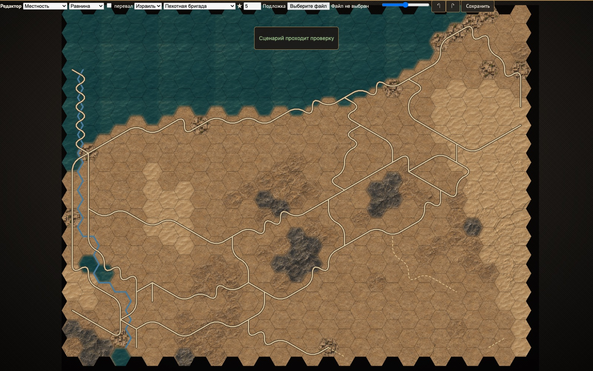
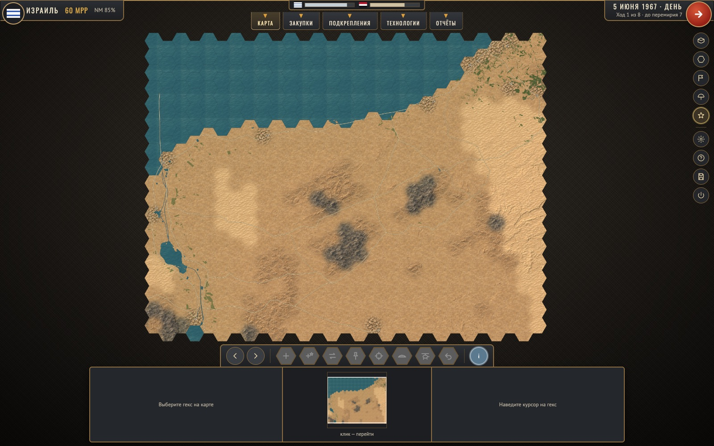

# Карта «Синай-67» и дороги 1967 года

Отчёт от 2026-11-26 (этап 4, шаг 5).

## Карта

- **Рамка:** 32,2…34,9° в. д., 29,8…31,6° с. ш. (решение дизайнера). Шарм-эш-Шейх вне карты.
- **Гекс:** 10 км, карта **29 × 19 гексов** (в разделе 14 было 22 × 20).
- **Рельеф:** Copernicus DEM GLO-30, 9 тайлов N29–N31 × E032–E034.
- **OSM:** выжимка BBBike по рамке (`data/raw/sinai67/sinai67.osm.pbf`).
- **Местность:**

  | Тип | Гексов |
  | --- | --- |
  | Равнина | 278 |
  | Вода | 130 |
  | Дюны | 66 |
  | Холмы | 47 |
  | Горы | 16 |
  | Город | 12 |
  | Перевал | 2 |

- **Настройки** — `data/mapgen-sinai67.json` (у «Голан» прежние, `data/mapgen.json`):
  - **Море по рельефу.** Гекс — вода, если половина его точек на высоте не больше 0,5 м или без данных: в выжимке OSM море не площадь, а береговая линия.
  - **Каналы.** Каналом на сторонах гексов считается только Суэцкий канал (`canal_names`). Вади Синая размечены в OSM как реки (`waterway=river`), но они сухие, и препятствием не считаются.
  - **Без автоматических мостов.** В 1967 году через канал ходили паромы, мостов нет (`auto_bridges: false`).
  - **Горы — от перепада 400 м.** На гексах 10 км массивы Халаль, Яллак, Магхара и хребет у Митлы и Гидди иначе выходят холмами.
  - **Запекание с половинным разрешением.** 12 пкс/км: гекс 10 км на экране такого же размера, как гекс 5 км «Голан». Тайлы весят 13 МБ.

## Дороги 1967 года

Слой `historical_roads` в `map.json`, включён (`roads_from: historical_roads`), дороги OSM сохранены в `osm_backup`. Получилось 178 сторон с дорогой, 8 с грунтовкой, 0 мостов и 1 новый перевал.

- **29 дорог:** 21 шоссе, 5 второстепенных, 3 грунтовки.
- **4 помечены как предположение:**
  - последние 6 км Кусейма — Абу-Агейла;
  - отрезок у Порт-Тауфика на восточном берегу;
  - грунтовка Нахль — Темед;
  - Рафах — Ницана через демилитаризованную зону.

**Охват:**
- **Север:** прибрежная дорога Кантара — Романи — Бир-эль-Абд — Эль-Ариш — Рафах и дорога вдоль Газы.
- **Канал:** дороги по западному берегу Порт-Саид — Исмаилия — Суэц с выходами на Каир, восточный берег и дорога восточнее Горьких озёр.
- **Центр:** Исмаилия — Таса — Бир-Гифгафа — Джебель-Либни — Абу-Агейла; Эль-Ариш — Джебель-Либни — Бир-Хасана; Эль-Ариш — Абу-Агейла.
- **Юг и перевалы:** дороги через Митлу и Гидди к Нахлю и Бир-Тамаде; связки к Кусейме и Ницане.
- **Негев:** Беэр-Шева — Ницана и Беэр-Шева — Газа.

### Источники

Карты открыты и прочитаны по изображению. Привязка: углы листов по сетке Палестины (EPSG:28191), обратная Кассини — Зольднер на Clarke 1880. Совпадение с подписанными координатами углов — меньше 1″, с известными пунктами (Кантара, Порт-Саид, Абу-Агейла, Бир-эль-Абд, аэродромы зоны канала) — в пределах 0,5 км. Точность точек дорог — около 0,5–1 км.

1. **Survey of Israel, «Синай» 1:100 000, листы 31–50** (20 листов, Wikimedia Commons, собрание Эрана Лаора). Составлены в 1958 году по британской съёмке 1914–1915 годов (G.S.G.S. 2230) и данным 1956 года. Частичное обновление 1964 года — зелёной надпечаткой с пометкой «не точная съёмка». Напечатаны в июле 1967 года. Основа слоя.
2. **Survey of Israel, «Северный Синай» 1:100 000**, временное издание октября 1956 года, листы 33 «Эль-Ариш» и 36 «Абу-Агейла». Использованы там, где нет листов 1967 года (Шейх-Зувейд — Рафах), и для сверки.
3. **Survey of Israel 1:100 000, лист 17 «Ницана»**, обновлён в январе 1960 года.
4. **Палестина 1:100 000, листы 11 «Газа», 14 «Рафах», 15 «Беэр-Шева»** — основа 1940-х в израильском издании 1950-х.
5. **Дорожная карта Израиля, врезка «Синай» 1:2 000 000** (1960-е, до 1967 года) — только как обзор сети.

Ссылки на конкретные листы — в поле `source` каждой дороги в `map.json`.

**Найдены, но не открыты:**
- брифинг-карта AMS июля 1967 года 1:1 500 000 (Commons) — для сверки класса дорог, как для «Голан»;
- листы AMS 1:250 000 (K502/P502) и карты ЦРУ в библиотеке Техасского университета — сайт не пускает автоматический доступ;
- AMS «Египет» 1:100 000 (1941) и британские листы времён Первой мировой — старее использованных.

### Что проверить

- **Класс перевала Митла.** На карте участок через перевал — дорога второго класса. Вся дорога поднята до шоссе как главная ось; можно понизить.
- **Восточный берег канала севернее 30,74° с. ш.** Лист «Эль-Кантара» обновлён в октябре 1967 года, после войны.
- **Дороги через демилитаризованную зону у Ницаны** (Кусейма — Ницана, Рафах — Ницана): их состояние в 1967 году неясно.
- **Грунтовка Нахль — Темед:** при этом масштабе может оказаться линией телеграфа.
- **Не нанесены:** тупиковые ветки, лагерные дороги зоны канала, прямая Нахль — Кунтилла (видны лишь слабые следы).

## Аэродромы

10 гексов с аэродромом (`airfields` в `map.json`, координаты и источники — `airfield_sources`):

- **Египетские на Синае:** Эль-Ариш, Бир-Гифгафа, Бир-Тамада, Джебель-Либни.
- **Египетские в зоне канала:** Файид, Кабрит, Деверсуар, Касфарит, Шаллуфа.
- **Израильский:** Хацерим.

Существование и удары 5 июня 1967 года (операция «Мокед») — по обзорным историям операции. Координаты — по Википедии там, где они совпали с картой в пределах 0,5 км, иначе по листам Survey of Israel.

- **Абу-Сувейр** (около 32,1° в. д.) лежит западнее рамки и в карту не вошёл. При необходимости — база вне карты.
- **Использование Деверсуара, Касфарита и Шаллуфы в июне 1967 года не подтверждено:** они отмечены на листах вручную.
- **Бир-Гифгафа:** знак на карте примерно в 4 км к северо-западу от нынешнего аэродрома; взяты нынешние координаты.
- **Посадочные площадки** у Кусеймы, Нахля и на листе 38 в аэродромы не включены.
