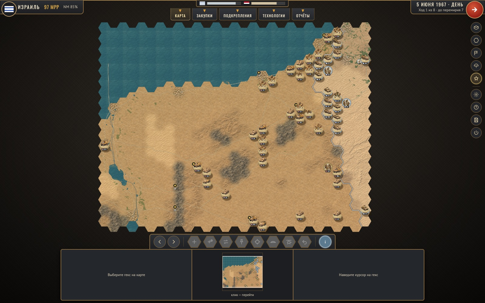

# Сценарий «Синай-67»: силы, цели, события

Отчёт от 2026-11-26 (этап 4, шаг 6). Карта и дороги 1967 года — в [отчёте о карте](2026-11-26-roads-sinai67.md).

## Что в сценарии

- **5–8 июня 1967 года, 8 ходов** по 12 часов: ход 1 — день 5 июня.
- **Силы: 48 наземных юнитов (бригад и штабов).** Израиль 16, Египет 32. Каждый взят из источника: у юнита в `scenario.json` есть поля `source` и `confirmed`. Неподтверждённых — 11 (1 израильский, 10 египетских), они перечислены ниже в «Открытых вопросах».

  | Класс | Израиль | Египет |
  | --- | --- | --- |
  | Штабы | 4 | 8 |
  | Танковые | 6 | 9 |
  | Механизированные | 1 | 2 |
  | Пехотные | 1 | 10 |
  | Десантные и коммандос | 2 | 1 |
  | Артиллерийские | 2 | 2 |

- **Штабы и подчинение.**
  - Израиль: Южный округ (рейтинг 8), 84-я дивизия (9), 38-я (8), 31-я (7); отдельные 8-я бронетанковая и 11-я пехотная бригады подчинены Южному округу.
  - Египет: штаб полевой армии и штабы дивизий (5–6); отдельные бронетанковые бригады второй линии подчинены штабу армии.
- **Имена.** Имён командиров нет. Соединение, названное по командиру, названо «отдельной бронетанковой группой».
- **Расстановка.** Координаты из источников переведены в гексы. Если гекс занят, водный, горный или не своей стороны, юнит встаёт в ближайший подходящий гекс. Точность источников ±5–10 км, то есть около гекса.
  - Окопы: египетская пехота первой линии (Рафах, Умм-Катеф, Газа, Джиради, Кусейма) — 4, остальная пехота и артиллерия Египта — 2.
  - Опыт: 7-я бронетанковая и парашютные бригады Израиля — 1 звезда.
  - Мораль: Израиль 85%, Египет 75%.
- **Правки карты.**
  - Хребет Митла — Гидди вдоль 33° в. д. стал горами, а перевалами — гексы, где его пересекают дороги 1967 года: Митла (8, 17) и Гидди (8, 15). На запад остаются три прохода: центральная дорога через Тасу, Гидди и Митла.
  - Укрепрайоны: Умм-Катеф и узел Рафаха.
  - Эль-Ариш — береговой город.
  - Контроль — по линии перемирия 1949 года.
- **Авиация** — опция сценария `first_strike` (у юнитов условие `when`).
  - Израиль: 2 истребительных и 4 ударных крыла (одно в Хацериме, остальные на базе вне карты на севере).
  - Египет при `free`: 5 истребительных и 5 ударных крыльев на аэродромах Синая и зоны канала и на базе в дельте Нила (вне карты, на западе).
  - Египет при `historical` (по умолчанию): к концу 5 июня потеряно около 70% (Long 1984, Oren). Остались 3 потрёпанных крыла на базе в дельте: сила 5–6, мораль 50%. Повреждения аэродромов на Синае моделируются тем, что там нет египетской авиации.
  - Один игровой юнит — примерно 30–40 самолётов. Так разложил авиацию я сам, источники этого не дают.
- **Цели** (очки / NM):

  | Цель | Очки | NM |
  | --- | --- | --- |
  | Абу-Агейла / Умм-Катеф | 15 | 10 |
  | Эль-Ариш | 15 | 10 |
  | Бир-Гифгафа | 10 | 5 |
  | Перевал Гидди | 20 | 10 |
  | Перевал Митла | 20 | 10 |
  | Газа | 5 | 5 |
  | Нахль | 5 | 3 |

- **Событие «приказ египетского командования об отходе».** Ход 4 (вечер 6 июня) или раньше, если Израиль держит и Абу-Агейлу, и Эль-Ариш. Египетским частям −20 морали, −2 окопа, −15 п. п. готовности до их фазы. Срабатывает в фазу Израиля, как в «Голанах-67».
- **Победа — предварительная**, подстройка на шаге 7: Израиль 40 / решительная 80, Египет 1 / решительная 30.
- **Подсказки ИИ.** Израиль — агрессивность 0,75, порядок целей: Абу-Агейла, Эль-Ариш, Бир-Гифгафа, Гидди, Митла. Египет — 0,4.

## Первый прогон ИИ против ИИ (не баланс)

200 партий v1 против v1: 0,67 мс на фазу, отказов ядра нет.

- **Исход:** доля Израиля (ничья — половина) 22,5%, Египта 77,5%, ничьих 17%.
- **Потери:** Израиль теряет за партию в среднем 26 шагов, Египет — 108.
- **Манёвр:** за партию 2,3 отступления и 1,7 занятия гекса; 6 уничтоженных юнитов, из них 0,7 в окружении.
- **Причина:** ИИ за Израиль наносит большие потери, но не доходит до дальних целей.

Баланс — на шаге 7, как решено.

## Источники составов и расстановки

Рамка 32,2…34,9° в. д. × 29,8…31,6° с. ш. Ход: 1 = 5 июня, день (06:00–18:00), 2 = 5 июня, ночь, … 8 = ночь с 8 на 9 июня. Время дано израильское; в Каире было на час больше.

## Чем пользовался

Книги Данстена, Поллака, Орена и Хэммела в сети целиком недоступны. Сайты .mil не открываются, archive.org выдаёт только метаданные, DOI ведёт к платному доступу. Поэтому эти книги использованы через вторичные пересказы, и у каждого факта указано, через какой именно.

| Ключ | Источник | Что дал | Надёжность |
| --- | --- | --- | --- |
| WOOB | Wikipedia, «Six-Day War order of battle», https://en.wikipedia.org/wiki/Six-Day_War_order_of_battle (ссылается на Dunstan 2009, без страниц) | Израильские бригады по дивизиям; египетские дивизии | средняя: 1-я и 125-я бронетанковые бригады по ошибке вёрстки стоят под 20-й палестинской дивизией |
| MODSP | Modern Spearhead, «Egyptian Army 1967», PDF (собран по Dunstan, Oren и Zaloga) | Танки египетских дивизий; 1-я и 125-я бронетанковые бригады в 6-й механизированной; отдельная бронетанковая группа — 4 танковых батальона, ~120 T-55 | средняя |
| LONG | C. B. Long, ACSC 1984, DTIC ADA146294 (текст на archive.org) | Приложение B (египетские составы); хронология; потери в воздухе | средняя |
| ABU | Wikipedia, «Battle of Abu-Ageila (1967)» (по Gawrych, «Key to the Sinai», CSI 1990) | 2-я пехотная дивизия по батальонам; 38-я дивизия | высокая для 2-й дивизии |
| HERAFAH | he.wikipedia, «קרב רפיח (1967)» | 7-я пехотная дивизия; 84-я дивизия по батальонам и танкам | высокая |
| HEFRONT | he.wikipedia, «החזית המצרית במלחמת ששת הימים» | Номера бригад (108, 16, 14, 114); хронология с часами; «Мокед» | средняя |
| HE31 | he.wikipedia / hamichlol, «עוצבת עמוד האש» (D. Asher, «Маарахот» 471) | 31-я дивизия; египетская 14-я бронетанковая бригада (T-54) | высокая |
| MOD | Архив Минобороны Израиля, «The Egyptian Front» | Номера бригад трёх дивизий | высокая, но мало подробностей |
| WSDW | Wikipedia, «Six-Day War» (Oren 2002, с. 181 и 202; Pollack 2004, с. 59) | 112-я бригада на Джиради; Эль-Ариш 6 июня, 07:50–08:00 | средняя |
| WH1/WH2 | WarHistory.org, «The Sinai Campaign of 1967», части I и II | Танки по соединениям; бои | средняя (источник не назван) |
| MOVES | H. Barasch, Moves № 15 (SPI, 1974) | 11-я, 16-я, 19-я НГ, 107-я ПОА; артиллерия 49-я и 57-я; две отдельные бронетанковые бригады второй линии | низкая–средняя |
| AVAL | Avalanche Press, «1967: Sword of Israel» (2013), сценарии | Номера батальонов | низкая (варгейм) |
| ACIG | Cooper & Vajda / Cooper & Baker, ACIG.org (2003): составы ВВС Египта и Израиля | Самолёты по типам и базам | средняя–высокая |
| GAWJCH | Gawrych, JCH 26:2 (1991), только фрагмент из поиска | 2-я бронетанковая бригада у Бир-Тамады | высокая, но фрагмент |

Номера бригад из варгейма Wars Across the World (2026) — 141-я, 20-я, 28-я и др. — только как подсказка; везде, где они встречаются, стоит `confirmed: false`.

## Расхождения и выбор

- **Парашютная бригада 84-й дивизии.** У Данстена она 202-я, в архиве Минобороны — 35-я. Это одно соединение, юнит один. 55-я бригада ушла в Иерусалим, на карту не ставится.
- **Центурионы при 14-й бригаде.** Батальон 63-й (ABU) или 226-й (WOOB, AVAL). Влит в бригаду, номер не важен.
- **Артиллерийская группа 214.** По WOOB она в 38-й дивизии, по HE31 — в 31-й. У 38-й оставлена безымянная группа из 6 дивизионов, у 31-й артиллерия влита в бригады.
- **Позиция Умм-Катеф.** Её держит 12-я бригада (Gawrych), у MOVES — «125-я». Выбрана 12-я.
- **Танки и артиллерия 2-й дивизии.** 6-й танковый полк и 51-я артиллерийская бригада (Gawrych). У AVAL вместо них 24-я танковая и 26-я/27-я артиллерийские. Выбран Gawrych.
- **Джиради.** По Орену его держит 112-я бригада. У AVAL там 6-я, а 112-я — у Бир-Лахфана; у WaW — 28-я. Выбран Орен.
- **16-я бригада.** HERAFAH называет её механизированной, MOVES — пехотной. Выбрана пехота: она в окопах.
- **1-я и 125-я бронетанковые бригады.** Они в 6-й механизированной дивизии (LONG, MODSP); в WOOB — ошибка вёрстки.
- **Падение Эль-Ариша.** Утро 6 июня (Орен); у LONG — полночь, у WH2 — 7 июня. Выбрано утро 6 июня, ход 3.
- **Абу-Агейла.** 06:00 (LONG) или около полудня 6 июня (ABU). В обоих случаях ход 3.
- **Газа.** 6 июня по WSDW и MOVES, полдень 7 июня по HEFRONT. Выбран ход 3, без подтверждения.
- **Приказ об отходе.** Источники называют от утра (LONG, Grossgold) до второй половины дня 6 июня (HEFRONT). Принят вечер: событие на ходу 3, действует с хода 4, как в плане этапа 4. Время 17:00 — компромисс.
- **Перемирие.** 21:30 8 июня по HEFRONT, 04:35 9 июня по каирскому времени у LONG. Принят ход 8.
- **ВВС Египта.** 431 боевой самолёт по ACIG, 420 по Орену. К концу 5 июня потеряно ~286–300 (около 70 %), за войну — 338.

## Открытые вопросы

1. **Номера бригад 3-й пехотной дивизии** не найдены. 114-я есть только в HEFRONT. Вторая бригада — заглушка.
2. **Две отдельные бронетанковые бригады второй линии.** 14-я подтверждена. Номер второй («141-я») подтверждён только варгеймом.
3. **4-я бронетанковая дивизия.** Номер есть только у 2-й бригады. 3-я бронетанковая и механизированная (у AVAL — 18-я) не подтверждены.
4. **Состав и точное место отдельной бронетанковой группы.** Где-то между Кусеймой и Кунтиллой. Командос-бригада подтверждена только у MOVES.
5. **Механизированная бригада 6-й дивизии**, разбитая у Нахля, без номера. Точные позиции 1-й и 125-й бронетанковых бригад неизвестны.
6. **Время взятия Кунтиллы** 8-й бригадой не найдено, поэтому этого события в `events.json` нет.
7. **Аэродромы.** Был ли разрушен Джебель-Либни при первом ударе, не установлено: в списке первой волны HEFRONT его нет, но ACIG размещает там самолёты. Использовались ли в 1967 году Девесуар, Кабрит-Касфарит и Шаллуфа — тоже не установлено (см. `map.json`).
8. **Координаты** восстановлены по карте и топонимам с точностью ±5–10 км, то есть примерно один гекс. Сверить их с гексами `map.json`.
9. **Проверить по книгам**, если появится доступ: Dunstan 2009, с. 17–25 (составы и карта); Pollack, с. 59–75; Oren, с. 170–210; Gawrych 1990, глава 3.
