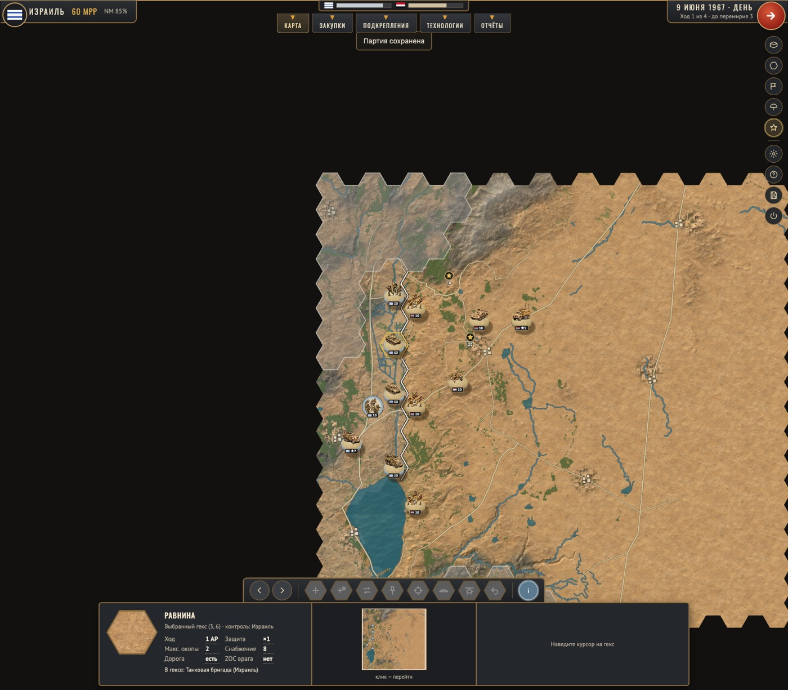
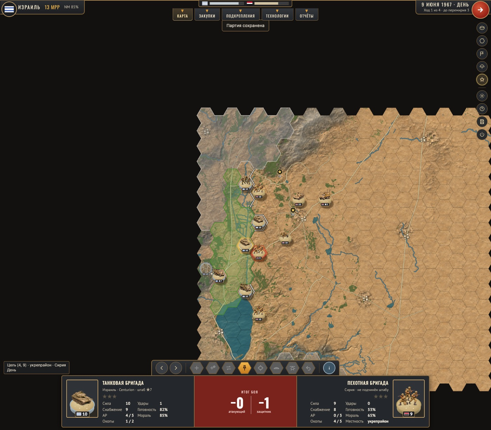
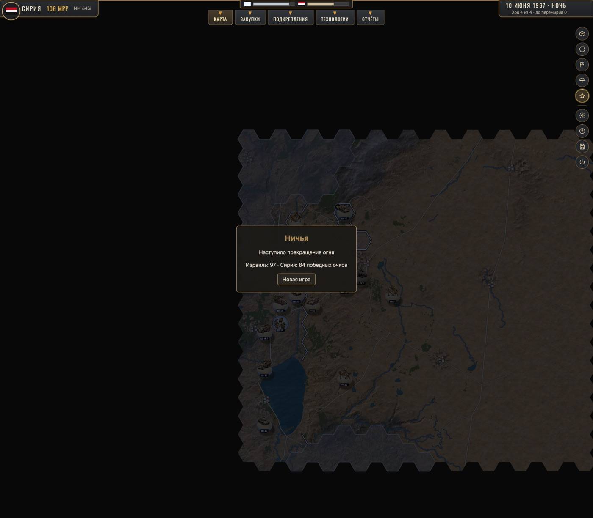

# Приёмка этапа 3: «Голаны-67» через интерфейс

Критерий этапа (раздел 18 GDD): партию «Голаны-67» можно сыграть от начала до конца в браузере, хотсит, все команды сценария доступны в интерфейсе, есть панели R-UI-04, слои R-UI-02/03 и удобство R-UI-05, тумана войны нет.

**Итог: критерий выполнен.** Прогон `npm run e2e` (`client/e2e/fullgame.mjs`, экран 1600 × 1400) сыграл партию за обе стороны до прекращения огня: 4 хода, 8 фаз, ничья, победные очки Израиль 97 · Сирия 84. Ошибок на странице нет. Скрипт действует только через интерфейс: щелчки по юнитам, гексам и целям, кнопки HUD, вкладки и клавиши. Состояние ядра он читает лишь для того, чтобы выбрать, куда щёлкнуть, и в конце сверяет журнал команд.

## Команды сценария через интерфейс

| Команда | Как отдана | Итог |
| --- | --- | --- |
| Ход (R-MOVE-01) | щелчок по зелёному гексу | да, 26 раз |
| Атака (R-COMBAT-02) | щелчок по цели, прогноз, второй щелчок | да, 10 раз |
| Обстрел (R-COMBAT-04) | панель действий → «Обстрел» → цель → «Обстрелять» | да |
| Обстрел моста (R-MOVE-02) | панель действий → «Обстрел» → мост в списке | да |
| Пополнение и элитное пополнение (R-ECO-02) | панель действий | да, оба |
| Переброска (R-MOVE-05) | панель действий → синий гекс | да |
| Булавка к штабу (R-HQ-01) | панель действий → штаб в списке | да |
| Ускорение технологии (R-TECH-02) | вкладка «Технологии» → «Купить» | да |
| Конец фазы (R-TURN-01) | красная кнопка и Enter, по очереди | да, 8 раз |
| Занятие гекса (R-COMBAT-06) | кнопка после боя | **не возникло**, см. ниже |
| Закупка (R-ECO-03) | вкладка «Закупки» | в сценарии нет: лимиты сил не заданы |
| Наведение моста (R-MOVE-02) | панель действий | в сценарии нет инженеров |

## Проверки HUD и удобства

Все прошли:
- **вкладки:** «Карта», «Закупки», «Подкрепления», «Технологии», «Отчёты»;
- **слои:** снабжение, ZOC, штабы, зонтики ПВО, цели — каждый включается и выключается;
- **круглые кнопки:** настройки (вид юнитов запоминается), справка, сохранение, меню с «Продолжить»;
- **режимы окна:** миникарта переносит камеру; «i» переключает окно на гекс и обратно;
- **клавиши:** N выбирает юнит; Ctrl+Z возвращает юнит на место.

Скриншоты обоих режимов окна — в [отчёте о HUD](2026-11-26-hud.md).

## Что осталось до этапа 4

1. **Занятие гекса в «Голанах-67» на практике не возникает.** Отступление (R-COMBAT-06) требует, чтобы у защитника осталась сила ≤ 3 или он потерял ≥ 3 шага при готовности ниже 50%. Ожидаемые потери за атаку здесь 0,4–0,7 шага, и за 4 хода до порога не доходит: в шести прогонах с разными целями ни одного отступления. Кнопка «Занять гекс» есть, но в этом сценарии проверить её нечем. Вопрос дизайнеру: так и задумано (короткий сценарий, укреплённая линия) или пороги отступления / длину сценария стоит пересмотреть? Проверить кнопку можно и на «Синае-67» (этап 4).
2. **Закупки и наведение моста** в живой партии не проверены: в «Голанах-67» их нет. Проверка — на «Синае-67» (закупки) и в 1973 году (инженеры).
3. **Вертолётная переброска (R-AIR-04)** в ядре не реализована; кнопка выключена с объяснением. По плану — этап 5.
4. **Открытые вопросы дизайнеру** из журнала решений:
   - названий соединений («7-я танковая бригада») в данных нет, поэтому окно атаки показывает класс юнита;
   - ливанские участки дорог 1967 года — допущения.
5. **Сенсорные экраны.** Наведения нет, поэтому правая карточка режима гекса и строка курсора на них не работают; прогноз открывается касанием. Раскладка для узких экранов проверена только скриншотами (600 px), на реальном телефоне — нет.
6. **Подкрепления из событий сценария** заранее не показываются, так задумано (их задают триггеры). Если нужно расписание прибытия, это отдельное решение.
7. **Реплей хода противника** отложен на этап 6 (решение дизайнера).
8. **Переключение этапа.** После приёмки AGENTS.md нужно перевести на этап 4 («ИИ v1 и «Синай-67»»), как это было при закрытии этапа 2.
