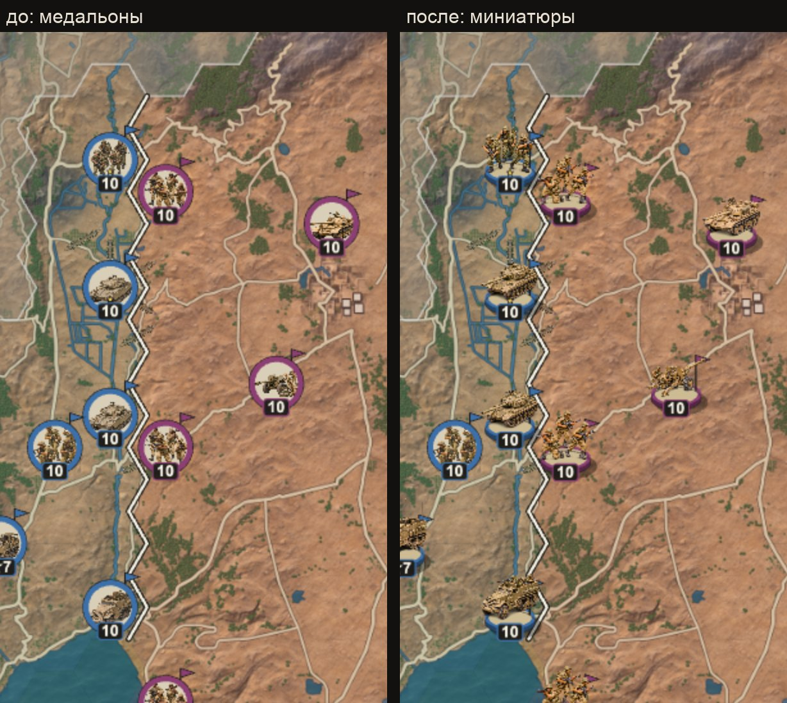
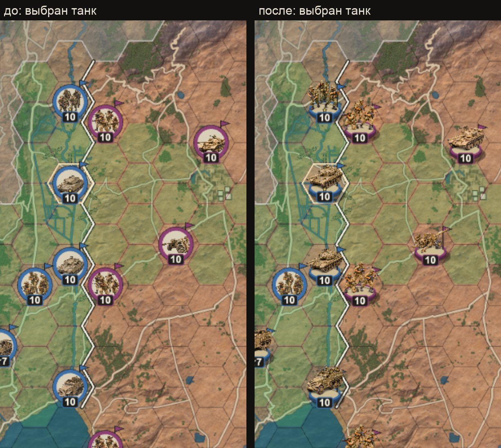
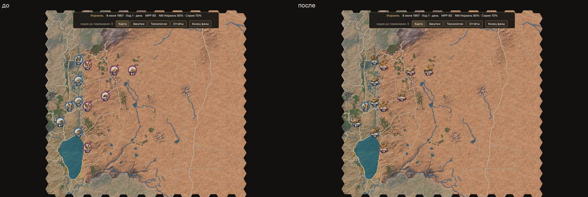
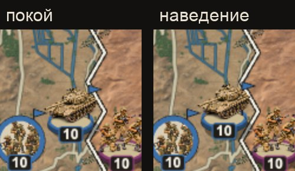

# Юниты-миниатюры и визуальные правки этапа 3

Отчёт от 2026-11-26. Этап 3, между шагами 2 и 3. Решения записаны в `docs/decisions.md`, правила — R-UI-02, R-UI-03, R-UI-06.

Скриншоты сняты так же, как в [отчёте от 2026-11-25](2026-11-25-render.md):
- headless Chrome, окно 1400 × 900, масштаб устройства 2;
- та же область: от центра гекса (1, 2) до центра гекса (8, 13);
- «Голаны-67» на запечённой карте.

Кадр «до» снят в запасном режиме `?units=medallion`, это прежний вид юнитов. Выбран танк в (3, 6).

## Что сделано

**Миниатюры** (новое):
- Пакет `assets/units_minis/` (32 модели) проверен `sim assets-check`: формат, прозрачная рамка, низ модели на `anchor` из манифеста ±0,06. Отчёт — `docs/assets-report.md`.
- Подставка нарисована кодом: тёмная боковина, обод цвета стороны, светлый грунт сверху.
- Модель стоит на своей точке опоры (`anchor`), кругом не обрезается и выступает над подставкой.
- Тень лежит на юго-восток: свет с северо-запада, как у отмывки.
- Плашка силы на передней кромке, звёзды опыта над ней, маленький вымпел цвета стороны.
- При наведении юнит приподнимается, тень остаётся на месте.
- Юниты рисуются в порядке «сверху вниз»: нижние перекрывают верхние.
- Старые медальоны — запасной режим. Он включается автоматически для спрайтов без миниатюры: `egy_mig17`, `egy_saiqa`, `isr_atgm_team`, `isr_hawk`, `isr_paratroopers` (коммандос Израиля на кадрах). Вручную — `?units=medallion` или клавиша U.

**Сделано раньше**, на кадрах видно вместе с миниатюрами:

| Пункт | Коммит | Где видно |
| --- | --- | --- |
| Текстуры местности в мировых координатах, мягкое смешивание на границах типов | `7d1ec4c`, в игре — `mapgen bake` (`3487b59`) | вся карта |
| Дороги от центра гекса к центру соседа; по сторонам гексов — только реки и канал | `9ab8150` (живой рендер); на запечённой карте — линии OSM | крупный план |
| Заливка контроля цветом стороны и линия фронта | `8733b55` | крупный план, белая ломаная |
| Сетка почти невидима, проявляется при выборе юнита | `0e5fc57` | выбор танка |

## До и после

Приподнимание при наведении:

## Что осталось

- Пять моделей без миниатюры: на их месте пока медальоны.
- Модели песочного цвета на песчаной карте читаются хуже медальонов. Выделяют их обод подставки и тень. Если этого мало, можно добавить тонкую тёмную обводку силуэта.
